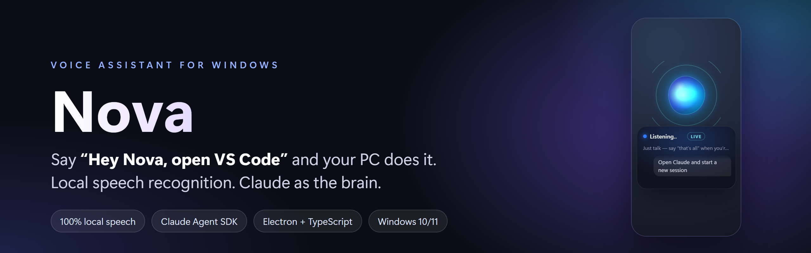
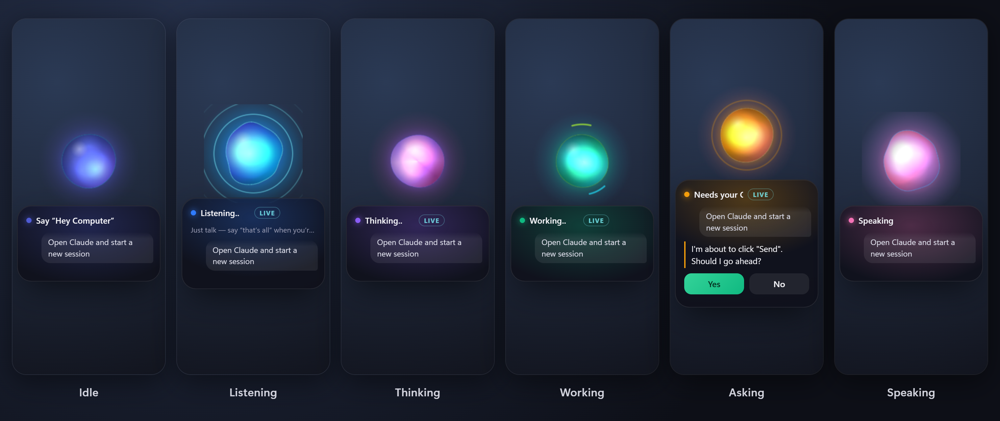
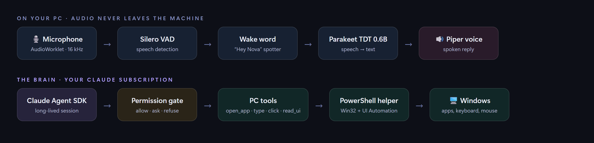

<p align="center">
  
</p>

<p align="center">
  
  
  
  
  
  
</p>

# Nova: your voice assistant for Windows

Control your Windows PC by talking to it. Say **"Hey Computer, open Visual Studio Code"**, or press **Ctrl+Alt+V** and say what you want. Claude (on your own subscription) works out the steps and does them with the keyboard, mouse and apps.

- **Speech recognition is local and free.** It uses Silero VAD + NVIDIA Parakeet TDT 0.6B through sherpa-onnx, so your audio never leaves the PC.
- **The brain is Claude.** It uses the Claude Agent SDK, signed in with your Claude subscription (no API key). Every command counts toward your subscription's usage limits.
- **Replies are spoken** by a natural local voice (Piper "lessac", free and offline). It plays inside the app, so the microphone's echo cancellation removes it: the assistant doesn't hear itself on laptop speakers, and you can talk over it.

<p align="center">
  
</p>

## Setup (once)

PowerShell on this PC blocks `npm`'s script wrapper, so use `npm.cmd`:

```bash
npm.cmd install
```

```bash
npm.cmd run models
```

```bash
npm.cmd run login
```

`models` downloads about 550 MB of speech models into `models/`: voice detection, a small wake-word listener for "Hey Nova", Parakeet speech recognition and the Piper voice. `login` opens a browser to sign in with your Claude account. Check it with `npm.cmd run login-status`.

## Run

```bash
npm.cmd run dev
```

A mic icon appears in the tray and a small orb docks in the middle of the right screen edge. When it's active, a slim card opens under the orb; hover the card for the text box and the Quit button.

| Orb colour | Meaning |
|---|---|
| grey | idle, waiting for "Hey Computer" |
| blue, pulsing | listening for your command |
| purple, spinning | Claude is thinking |
| green, spinning | doing things on your PC |
| orange | waiting for your yes / no |

**Ways to talk to it**
- Say **"Hey Computer, …"** with the command in one breath, or say "Hey Computer", wait for the chime, then give the command.
- Press **Ctrl+Alt+V**, click the orb, or click the tray icon, then speak.
- Type into the orb's text box.

**It's a conversation.** Wake it once, then just keep talking. No wake word or click is needed for follow-ups, and Claude remembers context: "open Notepad", then "now type my shopping list", then "save it on the desktop".
- It waits until you've really finished speaking, so short pauses mid-sentence don't cut you off.
- Talk over it while it's speaking and it goes quiet and listens to you.
- Ask for something new while it's working and it does that next.
- It goes back to sleep after 25 seconds of silence, or when you say "that's all", "bye" or "stop listening". The **LIVE** badge on the card shows the conversation is open.

**Say hello.** "Hello Nova" (or just "hello") gets an instant personal introduction: *"Good evening, Jawad! I'm Nova, your personal AI assistant. I can … What can I do for you today?"* Set your name with `userName` and hers with `assistantName` in the settings file.

**See it working.** While the AI is active, the edges of your screen glow (blue while listening, violet while thinking, green while working, pink while speaking). A status pill at the top shows its state (Listening, Thinking, Working on it, Speaking) and every click it makes leaves a soft ripple. It works quietly: no step-by-step narration and no talk about tools; replies are one short sentence about the result. These windows are hidden from the AI's own screenshots. Turn the glow off with **Screen glow while AI works** in the menu.

**Stop a task:** say "stop", press **Esc**, or press the hotkey again.

If it keeps interrupting itself (loud speakers, no headphones), turn off **Let me interrupt while it speaks** in the tray menu.

Try typed commands without the voice UI: `npm.cmd run try -- "open notepad and type hello"`.

## What else she can do

**Instant commands (under a second, no Claude).** Simple requests are done right on your PC, without waiting for Claude or using your subscription:

| Say | Does |
|---|---|
| "volume up" / "turn it down a lot" / "mute" | changes the volume |
| "pause the music", "next song", "previous track" | media keys |
| "open Notepad", "open YouTube", "open my downloads folder", "go to github.com" | opens the app, site or folder |
| "close Spotify" | closes that window |
| "show desktop", "minimize everything", "take a screenshot", "lock my computer" | the Windows shortcut |
| "what time is it", "what's the date" | answers straight away |

Anything longer ("open Notepad and type hello") or unclear goes to Claude as usual, and Claude is told about the instant commands you ran, so follow-ups like "now type my shopping list" still work. Turn this off with `fastCommands`.

**Memory.** Say "remember that my manager is Sara Khan" or "remember my project folder is D:\Work". Nova keeps these facts after a restart and uses them ("email my manager"). Ask "what do you remember about me?", or say "forget my manager". She never stores passwords or card numbers.

**Reminders and timers.** "Set a timer for 10 minutes", "remind me to call Ali at 5:30 pm", "remind me in 20 minutes to stretch", "remind me tomorrow at 9 to send the report". When one is due you get a Windows notification and Nova says it out loud, waiting until she's finished any task. Reminders survive a restart; one that came due while Nova was closed is said when she starts. "What are my reminders?", "cancel the timer".

**Routines.** One phrase runs several commands. Say "when I say *work mode*, open VS Code, open Slack and open GitHub", or make one in Settings. Then say "start work mode". Instant steps run immediately and the rest go to Claude together. A step can be `wait 3 seconds`.

**Files and the clipboard.** "Find the PDF I downloaded yesterday", "open my budget spreadsheet", "summarise what I copied", "copy that to the clipboard". File search uses the Windows Search index where it covers your folders, and otherwise scans Desktop, Documents, Downloads, Pictures, Music and Videos.

## Safety

Every action Claude takes goes through [src/brain/permissions.ts](src/brain/permissions.ts):
- **Runs immediately:** opening apps, typing, clicking, screenshots, reading the screen.
- **Asks you first (say yes or no):** deleting, moving or overwriting files; shutdown or restart; installing software; registry or service changes; downloads; killing programs; clicking buttons like Send, Buy, Pay or Delete. Claude is also told to read back any message before sending it.
- **Always refused:** typing card numbers, typing into password fields, changing Defender or the firewall, reading saved credentials.

## Settings

Tray menu → **Settings, memory & routines…** opens the Settings window. Most changes apply as soon as you save (a new model or speech recognizer restarts just that part). It also lists what Nova remembers, your routines and your reminders, and you can add or remove them there. Starting Nova again while it's running also opens Settings.

Everything is stored in `%APPDATA%\voice-control\`: `config.json` (below), `memory.json`, `routines.json` and `reminders.json`. You can edit them by hand too.

```json
{
  "userName": "Jawad",
  "assistantName": "Nova",
  "wakeWord": "hey nova, hey computer",
  "hotkey": "Control+Alt+V",
  "model": "sonnet",
  "sttModel": "parakeet",
  "whisper": "base.en",
  "wakeWordEnabled": true,
  "conversation": true,
  "followUpSeconds": 25,
  "bargeIn": true,
  "endOfSpeechMs": 1000,
  "speak": true,
  "voice": "",
  "screenGlow": true,
  "autostart": false,
  "fastCommands": true
}
```

- `followUpSeconds`: how long it keeps listening after you go quiet. `endOfSpeechMs`: raise it (for example to 1200) if it still acts before you finish a sentence.
- `model`: `sonnet` is fast. `opus` is smarter but slower and uses more of your limits.
- `sttModel`: `"parakeet"` (default, most accurate) or `"whisper"`. For Whisper, run `npm.cmd run models -- base.en` (or `small.en`) and set `whisper` to that name. If Parakeet isn't downloaded, Whisper is used.
- `ttsVoice`: the Piper voice (`"en_US-lessac-medium"`). Set it to `""` to use Windows speech instead. `ttsSpeed`: 1.1 speaks a bit faster.
- `voice`: part of a Windows voice name, for the Windows-speech fallback.
- `fastCommands`: do simple commands instantly without Claude (see above).
- If you edit `config.json` by hand, restart the app. Changes made in the Settings window apply straight away.

## Install on another PC

`npm.cmd run dist` builds `release\Nova-<version>-win.zip`: unzip it anywhere and run `Nova.exe`. For a proper installer (`Nova Setup <version>.exe`, with Start-menu entry and uninstaller), run the **Build Windows installer** workflow in the GitHub Actions tab, or push a tag like `v0.2.0`. The installer and zip appear as downloads (attached to a release, for tags).

On first launch, the installed app downloads the speech models (about 550 MB, once) and shows progress on the orb. Then use tray → **Sign in to Claude…** once.

The builds aren't code-signed, so Windows SmartScreen warns the first time ("More info → Run anyway"). On PCs with **Smart App Control** turned on, Windows blocks unsigned apps completely. There, use the developer setup above (`npm.cmd run dev`).

## How it works

<p align="center">
  
</p>

```
mic → orb window (AudioWorklet, 16 kHz) → speech worker (VAD → Parakeet) → text
text → wake-word check → Claude Agent SDK session → pc tools → PowerShell helper (Win32 / UI Automation)
```

| Path | What |
|---|---|
| [src/main/index.ts](src/main/index.ts) | Electron app: tray, orb, hotkey, voice state machine |
| [src/audio/worker.ts](src/audio/worker.ts) | Local speech recognition (separate process) |
| [src/audio/wake.ts](src/audio/wake.ts) | Wake-word / yes-no / stop matching |
| [src/brain/agent.ts](src/brain/agent.ts) | Long-lived Claude session |
| [src/brain/prompt.ts](src/brain/prompt.ts) | Instructions Claude follows |
| [src/tools/pc.ts](src/tools/pc.ts) | Tools Claude can use: open_app, window, type_text, press_keys, read_ui, click_element, screenshot, click, scroll, run_powershell, ask_user, find_files, clipboard, remember, set_reminder, save_routine… |
| [src/fast/commands.ts](src/fast/commands.ts) | Instant commands that skip Claude; [src/fast/when.ts](src/fast/when.ts) understands spoken times |
| [src/brain/memory.ts](src/brain/memory.ts), [reminders.ts](src/brain/reminders.ts), [routines.ts](src/brain/routines.ts) | Long-term memory, reminders and timers, routines |
| [src/win/files.ts](src/win/files.ts) | File search and clipboard |
| [src/main/settings.ts](src/main/settings.ts), [app/settings.html](app/settings.html) | The Settings window |
| [src/main/setup.ts](src/main/setup.ts) | Installed app: first-run model download, Claude sign-in |
| [app/helper.ps1](app/helper.ps1) | Win32 keyboard, mouse, windows, screenshots, UI Automation |

Tests: `npm.cmd test`.

## Limits

- A simple command takes about 5–20 seconds; tasks that click through apps take longer.
- Electron apps such as Claude, VS Code and Chrome expose few UI-Automation elements, so inside them Claude relies on keyboard shortcuts and screenshots, which is slower.
- It cannot control the lock screen or admin (UAC) prompts.
- While idle it transcribes any speech it hears to look for the wake word. That stays local, but it uses some CPU in a noisy room. Use **Pause wake word** in the tray to rely on the hotkey only.
- This is for personal use with your own Claude login.
